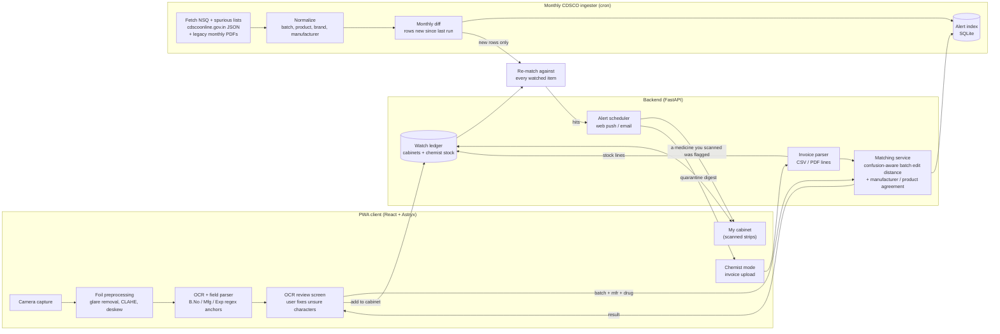

# StripSafe

Scan a medicine strip and find out whether that exact batch shows up in a CDSCO quality alert. If a batch you already bought gets flagged in a later monthly list, StripSafe tells you.

Built for **Parallax Hackathon 2026** (Unstop), Healthcare & Wellbeing track.

**Live demo:** coming soon
**Design (Figma):** https://www.figma.com/design/45KcUWIVmqTSxKlolPyWEA

## The problem

India's drug regulator tests medicine samples every month and publishes the batches that failed.

- In **September 2026 alone, 330 samples were declared Not of Standard Quality (NSQ)** and 1 spurious ([New Indian Express, 23 Oct 2026](https://www.newindianexpress.com/india/2026/Oct/23/cdsco-flags-330-drug-samples-as-not-of-standard-quality-in-september)). The CDSCO public list for that month has 330 NSQ rows.
- In **FY26, 3,012 samples were NSQ and 283 spurious or adulterated, out of 1,41,322 tested**. Most were everyday drugs: paracetamol, metformin combinations, amoxicillin, cough syrups ([Lok Sabha reply via ET Pharma](https://pharma.economictimes.indiatimes.com/news/regulatory-update/over-3000-drug-samples-found-not-of-standard-quality-in-fy26-govt-tells-lok-sabha/133045193)).
- About **6,956 NSQ batches** are on record from Jan 2019 to Sep 2026 ([blacklisted.co.in](https://blacklisted.co.in/medicines/nsq)).

Two things make these alerts nearly useless to the people holding the medicine:

1. **The risk is in the batch, not the brand.** CDSCO says the failure "is specific to the batch tested". You only know if you read the batch number off the foil and compare it with a government table.
2. **The alert comes late.** A list is published weeks or months after the strips have been sold. By then they're in a kitchen drawer or on a chemist's shelf, and nobody goes back to check.

Existing tools (blacklisted.co.in, pharmamithra.com) are searchable tables where you type the batch in by hand, once. I couldn't find any chemist software that matches CDSCO alerts against purchase invoices automatically.

## What StripSafe does

- **Scan:** point the phone at the strip. OCR reads the batch number, manufacturer and drug name off the foil. You can correct anything it isn't sure about.
- **Check:** the batch is matched against every CDSCO NSQ and spurious list, with fuzzy matching that knows common OCR mix-ups (0/O, 1/I/l, 5/S, 8/B, 2/Z), so a misread can't hide a real match and a near-miss doesn't raise a false alarm.
- **Watch:** every scanned strip goes into "My cabinet". When CDSCO publishes a new month, all cabinets are re-checked, and you get an alert like "a medicine you scanned on 12 Oct was just flagged".
- **Chemist mode:** upload a distributor purchase invoice (CSV or PDF) and get a quarantine list of flagged batches in stock, plus which customers bought them.

Results are worded as "this batch appears in CDSCO alert X" or "no CDSCO alert names this batch yet". StripSafe never calls a medicine "safe".

## Architecture



- **Client scan + OCR:** batch codes are low-contrast inkjet or embossed text on shiny foil, so the image is cleaned up before OCR. Characters the model isn't sure about are highlighted for the user to confirm.
- **Matching service:** compares the batch with an OCR-confusion map, then checks that manufacturer and product agree, so two different companies that happen to use the same batch code don't collide.
- **CDSCO list ingester:** pulls each month's NSQ and spurious lists, normalizes them into one SQLite index and keeps a diff of what's new since the last run.
- **Alert scheduler:** only the new rows are re-matched against every cabinet and stock ledger. Hits become push notifications for households and a quarantine digest for chemists.
- **Chemist mode:** invoice lines (product, batch, expiry, qty) go through the same matcher and land in the stock ledger, so a future list also catches stock that's already on the shelf.

## Data sources

All CDSCO data is public and free. I checked these on 25 Nov 2026:

| Source | URL | Format | Coverage |
| --- | --- | --- | --- |
| CDSCO NSQ & spurious portal (current) | https://cdscoonline.gov.in/CDSCO/viewPublicNSQDrug (embedded on https://cdsco.gov.in/opencms/opencms/en/Notifications/nsq-drugs/) | HTML page backed by JSON endpoints | Reporting years 2019 to 2026; latest month is Sep 2026 |
| CDSCO Drug Alerts page (legacy) | https://cdsco.gov.in/opencms/opencms/en/Notifications/Alerts/ | Monthly PDFs (text-based tables, Word-generated) | Monthly NSQ alert (CDSCO labs), State NSQ alert, spurious list; last monthly NSQ PDF is June 2025 |
| Banned FDC gazette lists | [156 FDCs, 2 Aug 2024](https://cdsco.gov.in/opencms/resources/UploadCDSCOWeb/2018/UploadNewsFiles/List%20of%20Prohibited%20FDC%20drugs_%20156%20FDCs_%20dated%2002.08.2024.pdf), [328 FDCs, Sept 2018](https://www.pib.gov.in/Pressreleaseshare.aspx?PRID=1545741) | PDF | For the composition overlay |

**How CDSCO publishes now.** On 28 Aug 2025 CDSCO posted a notice that NSQ alerts moved to a new link. The Alerts page still lists the older monthly PDFs, but new months appear on the cdscoonline portal. That page loads its tables from plain GET endpoints that return JSON (`{"aaData": [...]}`, served as `text/plain`, Latin-1 encoded):

| Endpoint | Returns |
| --- | --- |
| `GET /CDSCO/reportingYears?tab=nsq` | `["2019", ..., "2026"]` |
| `GET /CDSCO/publicReportingMonths?year=2026&tab=nsq` | `["Jan", ..., "Sep"]` |
| `GET /CDSCO/publicNsqDrugTable` | Latest month's NSQ rows (330 rows for SEP-2026) |
| `GET /CDSCO/filteredNsqDrugTable?month=Aug-2026&source=All&tab=nsq` | One month's NSQ rows; `source` is `All`, `State` or `CDL` (220 rows for AUG-2026) |
| `GET /CDSCO/viewPublicSpuriousDrugData` | Latest spurious rows |
| `GET /CDSCO/filteredSpuriousDrugTable` | Spurious rows by month and source |

NSQ row fields: `str_product_name`, `str_brand_name`, `str_batch_no`, `dt_manufacturing_date`, `dt_expiry_date`, `str_manufactured_by`, `str_nsq_result`, `str_reporting_source`, `str_reported_by_lab_or_state`, `dt_reporting_month_year`. Spurious rows also carry dosage form, route, manufacturer name and category.

Lists are monthly. The September 2026 list was out by 23 Oct 2026, so a new month usually lands three to four weeks after it ends. The ingester polls daily and only acts when a new month shows up. These are undocumented endpoints behind a public page, so the ingester caches raw snapshots and falls back to the legacy PDFs (parsed with pdfplumber) if the portal changes.

## Tech stack (planned)

| Layer | Choice | Why |
| --- | --- | --- |
| Frontend | React 19 + Vite PWA, [Astryx](https://github.com/meta/astryx) components (`@astryxdesign/core`, `theme-neutral`) | Accessible components, light/dark themes, installable on phones |
| Camera / OCR (client) | `getUserMedia`, OpenCV.js preprocessing | Glare removal, CLAHE, adaptive threshold, deskew before OCR |
| OCR (server) | PaddleOCR, Tesseract fallback | Free and offline-capable; good on short alphanumeric codes |
| Backend | Python 3.12, FastAPI | Simple API for match, cabinet, invoice upload |
| Matching | rapidfuzz + custom OCR-confusion cost map | Batch edit distance that knows 0/O, 1/I/l, 5/S, 8/B, 2/Z |
| Ingester | httpx + pdfplumber, cron | Portal JSON first, PDF fallback, monthly diff |
| Storage | SQLite | One file, enough for the demo and a few years of lists |
| Alerts | Web Push (VAPID) | No paid SMS or email service needed |

No paid APIs. Every data source is public.

## Setup

Coming soon. The app code isn't in the repo yet. The plan:

```bash
cp .env.example .env          # fill in local values, never commit .env
# backend
python -m venv .venv && source .venv/bin/activate
pip install -r backend/requirements.txt
python -m backend.ingest --months 24   # pull the last 24 months of CDSCO lists
uvicorn backend.main:app --reload
# frontend
cd web && npm install && npm run dev
```

## Design

Figma file with the user flow, high-fidelity mobile screens (light and dark) and Astryx-mapped components:
https://www.figma.com/design/45KcUWIVmqTSxKlolPyWEA

## Disclaimer

StripSafe reports whether a batch appears in a published CDSCO list. It isn't medical advice. Talk to a doctor or pharmacist before stopping a prescribed medicine.
