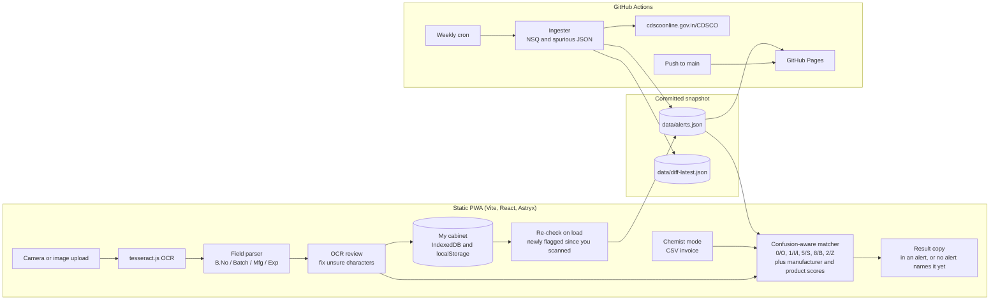

# StripSafe

Scan a medicine strip and find out whether that exact batch shows up in a CDSCO quality alert. If a batch you already bought gets flagged in a later monthly list, StripSafe tells you.

Built for **Parallax Hackathon 2026** (Unstop), Healthcare & Wellbeing track.

**Live demo:** https://ritesh-root.github.io/stripsafe/
**Design (Figma):** https://www.figma.com/design/45KcUWIVmqTSxKlolPyWEA

## The problem

India's drug regulator tests medicine samples every month and publishes the batches that failed.

- In **September 2026 alone, 330 samples were declared Not of Standard Quality (NSQ)** and 1 spurious ([New Indian Express, 23 Oct 2026](https://www.newindianexpress.com/india/2026/Oct/23/cdsco-flags-330-drug-samples-as-not-of-standard-quality-in-september)). The CDSCO public list for that month has 330 NSQ rows.
- In **FY26, 3,012 samples were NSQ and 283 spurious or adulterated, out of 1,41,322 tested**. Most were everyday drugs: paracetamol, metformin combinations, amoxicillin, cough syrups ([Lok Sabha reply via ET Pharma](https://pharma.economictimes.indiatimes.com/news/regulatory-update/over-3000-drug-samples-found-not-of-standard-quality-in-fy26-govt-tells-lok-sabha/133045193)).
- About **6,956 NSQ batches** are on record from Jan 2019 to Sep 2026 ([blacklisted.co.in](https://blacklisted.co.in/medicines/nsq)).

Two things make these alerts nearly useless to the people holding the medicine:

1. **The risk is in the batch, not the brand.** CDSCO says the failure "is specific to the batch tested". You only know if you read the batch number off the foil and compare it with a government table.
2. **The alert comes late.** A list is published weeks or months after the strips have been sold. By then they're in a kitchen drawer or on a chemist's shelf, and nobody goes back to check.

Existing tools (blacklisted.co.in, pharmamithra.com) are searchable tables where you type the batch in by hand, once. I couldn't find any chemist software that matches CDSCO alerts against purchase invoices automatically.

## What StripSafe does

- **Scan:** point the phone at the strip. OCR reads the batch number, manufacturer and drug name off the foil. You can correct anything it isn't sure about.
- **Check:** the batch is matched against every CDSCO NSQ and spurious list, with fuzzy matching that knows common OCR mix-ups (0/O, 1/I/l, 5/S, 8/B, 2/Z), so a misread can't hide a real match and a near-miss doesn't raise a false alarm.
- **Watch:** every scanned strip goes into "My cabinet". When CDSCO publishes a new month, all cabinets are re-checked, and you get an alert like "a medicine you scanned on 12 Oct was just flagged".
- **Chemist mode:** upload a distributor purchase invoice (CSV or PDF) and get a quarantine list of flagged batches in stock, plus which customers bought them.

Results are worded as "this batch appears in CDSCO alert X" or "no CDSCO alert names this batch yet". StripSafe never calls a medicine "safe".

## Architecture

The app is a static PWA. Matching, OCR and the cabinet all run in the browser. GitHub Actions refreshes the CDSCO snapshot and publishes the site. There is no server.



- **Scan and OCR:** the phone camera or an uploaded image is read in the browser with tesseract.js. The parser anchors on B.No / Batch, Mfg and Exp. Characters the reader is unsure about can be tapped through their lookalike spellings.
- **Matcher:** confusion twins cost nothing (0/O, 1/I/l, 5/S, 8/B, 2/Z). A real one-character edit is not enough on its own. Manufacturer and product names have to agree before a near miss is treated as the listed batch. A different company that reused a batch code does not get flagged when both names are present and disagree.
- **Cabinet:** scans stay on the device in IndexedDB, with a localStorage copy. Opening the app re-checks them against `data/alerts.json`. A batch that was clear at scan time and is named by a later list is marked “newly flagged since you scanned”.
- **Chemist mode:** a CSV purchase invoice is matched with the same function. Flagged lines become a quarantine list that can be exported as a PDF.
- **Ingester:** `scripts/ingest.ts` asks the public CDSCO JSON endpoints for every year and month, normalizes the rows, and writes `data/alerts.json` plus `data/diff-latest.json` (rows whose ids were not in the previous file). A failed fetch does not wipe a snapshot that already has rows. The weekly workflow commits the diff. Pages deploys that snapshot with the PWA.

## Data sources

All CDSCO data is public and free. I checked these on 25 Nov 2026:

| Source | URL | Format | Coverage |
| --- | --- | --- | --- |
| CDSCO NSQ & spurious portal (current) | https://cdscoonline.gov.in/CDSCO/viewPublicNSQDrug (embedded on https://cdsco.gov.in/opencms/opencms/en/Notifications/nsq-drugs/) | HTML page backed by JSON endpoints | Reporting years 2019 to 2026; latest month is Sep 2026 |
| CDSCO Drug Alerts page (legacy) | https://cdsco.gov.in/opencms/opencms/en/Notifications/Alerts/ | Monthly PDFs (text-based tables, Word-generated) | Monthly NSQ alert (CDSCO labs), State NSQ alert, spurious list; last monthly NSQ PDF is June 2025 |
| Banned FDC gazette lists | [156 FDCs, 2 Aug 2024](https://cdsco.gov.in/opencms/resources/UploadCDSCOWeb/2018/UploadNewsFiles/List%20of%20Prohibited%20FDC%20drugs_%20156%20FDCs_%20dated%2002.08.2024.pdf), [328 FDCs, Sept 2018](https://www.pib.gov.in/Pressreleaseshare.aspx?PRID=1545741) | PDF | For the composition overlay |

**How CDSCO publishes now.** On 28 Aug 2025 CDSCO posted a notice that NSQ alerts moved to a new link. The Alerts page still lists the older monthly PDFs, but new months appear on the cdscoonline portal. That page loads its tables from plain GET endpoints that return JSON (`{"aaData": [...]}`, served as `text/plain`, Latin-1 encoded):

| Endpoint | Returns |
| --- | --- |
| `GET /CDSCO/reportingYears?tab=nsq` | `["2019", ..., "2026"]` |
| `GET /CDSCO/publicReportingMonths?year=2026&tab=nsq` | `["Jan", ..., "Sep"]` |
| `GET /CDSCO/publicNsqDrugTable` | Latest month's NSQ rows (330 rows for SEP-2026) |
| `GET /CDSCO/filteredNsqDrugTable?month=Aug-2026&source=All&tab=nsq` | One month's NSQ rows; `source` is `All`, `State` or `CDL` (220 rows for AUG-2026) |
| `GET /CDSCO/viewPublicSpuriousDrugData` | Latest spurious rows |
| `GET /CDSCO/filteredSpuriousDrugTable` | Spurious rows by month and source |

NSQ row fields: `str_product_name`, `str_brand_name`, `str_batch_no`, `dt_manufacturing_date`, `dt_expiry_date`, `str_manufactured_by`, `str_nsq_result`, `str_reporting_source`, `str_reported_by_lab_or_state`, `dt_reporting_month_year`. Spurious rows also carry dosage form, route, manufacturer name and category.

Lists are monthly. The September 2026 list was out by 23 Oct 2026, so a new month usually lands three to four weeks after it ends. The GitHub Action runs weekly, fetches every published month, and commits only the rows that are new since the previous snapshot.

**Snapshot in this repo.** Refreshed 25 Nov 2026: **6,975 real CDSCO rows** (6,926 NSQ + 49 spurious) covering all 93 published months, JAN-2019 through SEP-2026 (331 rows in SEP-2026). The ingester retries with backoff and merges with the previous snapshot, so a flaky connection never drops months. The weekly GitHub Action adds new months as CDSCO publishes them.

## Tech stack

| Layer | Choice | Why |
| --- | --- | --- |
| App | React 19, TypeScript, Vite, [Astryx](https://github.com/meta/astryx) `@astryxdesign/core` and `theme-neutral` | Accessible components, Figtree, light and dark, the tokens used in the Figma file |
| PWA | vite-plugin-pwa, web manifest, service worker | Installable on a phone. Static files only, so GitHub Pages can host it |
| OCR | tesseract.js in the browser | No server and no paid OCR key. Unsure characters are shown for a tap |
| Matching | Confusion-aware edit distance in `src/lib/match.ts` | 0/O, 1/I/l, 5/S, 8/B, 2/Z cost nothing; manufacturer and product scores block false alarms |
| Cabinet | IndexedDB, mirrored to localStorage | Stays on the device. Re-checked against the snapshot when the app opens |
| Ingester | `scripts/ingest.ts` (Node 22 fetch) | Public CDSCO JSON, Latin-1 / windows-1252 decode, weekly diff |
| Hosting | GitHub Actions + GitHub Pages | `https://ritesh-root.github.io/stripsafe/` |

No paid APIs. Every data source is public.

## Setup

```bash
npm install
npm test          # parser and matcher
npm run ingest    # refresh data/alerts.json from CDSCO (needs a network that can reach the portal)
npm run dev       # http://localhost:5173/stripsafe/
npm run build     # static site in dist/, base path /stripsafe/
```

`npm run lint`, `npm run typecheck`, `npm test` and `npm run build` are what CI runs.

Copy `.env.example` to `.env` only if you need to point the ingester at a different CDSCO base URL. Do not commit `.env`.

### GitHub Pages

The deploy workflow uses `actions/deploy-pages` and runs on every push to `main`. In the repository, set **Settings → Pages → Build and deployment → Source** to **GitHub Actions**. Until that source is selected, the workflow cannot publish the site.

## Design

Figma file with the user flow and the mobile screens (light and dark), mapped to Astryx:
https://www.figma.com/design/45KcUWIVmqTSxKlolPyWEA

## Disclaimer

StripSafe reports whether a batch appears in a published CDSCO list. It isn't medical advice. Talk to a doctor or pharmacist before stopping a prescribed medicine.
